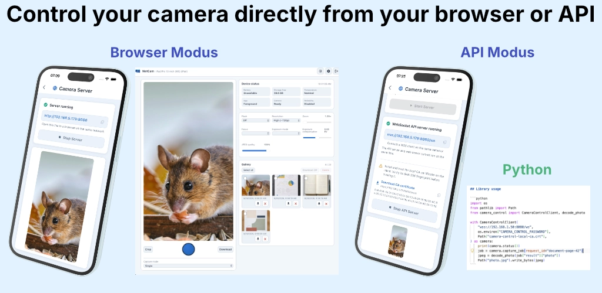

# Tripod Mode remote shutter



**Tripod Mode** is the NetCam screen for a phone fixed in a holder: a
fullscreen preview with one shutter button, then the taken photo with a
**delete** and a **next** button that both return to the preview. Tapping the
phone can move the holder, so the same three actions are also available as
plain `GET` links on the phone's web server. They need **no login**, which
makes them the easiest way to trigger NetCam from a script, a microcontroller
or a bookmark on a second phone.

The links only act while the Tripod screen is open on the phone. At any other
time they answer `409 {"error":"tripod_inactive"}` and nothing happens.

## Routes

| Route | Effect |
| --- | --- |
| `GET /photo` | Take a photo and show it for review (also from the review step, keeping the shown photo) |
| `GET /next` | Keep the shown photo and return to the preview |
| `GET /delete` | Delete the shown photo and return to the preview |
| `GET /remote/state` | JSON `{active, state, photo}` describing the Tripod screen |
| `GET /remote/photo` | The JPEG currently shown for review, `404` when there is none |
| `GET /remote` | A minimal page with the three buttons, for a second phone or tablet |

`state` is one of `inactive`, `preview`, `capturing` and `review`. Photos
taken this way land in the normal gallery and are counted against the cache
limit like every other photo.

## Who gets JSON and who gets the page

The server looks at the `Accept` header of the request:

- A client that accepts `text/html`, which every browser does, is redirected
  with `303 See Other` to `/remote`, where the outcome is shown.
- Every other client, such as `curl`, Python `requests` or an ESP32, gets a
  JSON answer.

Send `Accept: application/json` from scripts to be explicit. A request whose
`Sec-Purpose` or `Purpose` header contains `prefetch` is answered with
`204 No Content` and does nothing, so a bookmarked `/photo` cannot fire by
itself while a browser prefetches it. Only `GET` is accepted; other methods
get `405`.

## Responses

| Call | Response |
| --- | --- |
| `GET /photo` | `200 {"state":"review","photo":{"id":"…","takenAt":"2026-10-30T10:00:00.000Z","sizeBytes":123456}}` |
| `GET /next` | `200 {"state":"preview"}` |
| `GET /delete` | `200 {"state":"preview","deleted":"<id>"}`, or `"deleted":null` when nothing was shown |
| `GET /remote/state` | `200 {"active":true,"state":"review","photo":{…}}`, `photo` is `null` outside the review step |
| Tripod screen not open | `409 {"error":"tripod_inactive"}` |
| Camera busy | `409 {"error":"busy"}` |
| Camera unavailable | `503 {"error":"camera_unavailable"}` |
| Other camera error | `500 {"error":"camera","message":"…"}` |

## curl examples

Plain HTTP, the server's default on port `8080`:

```bash
curl -s http://192.168.1.50:8080/remote/state
curl -s http://192.168.1.50:8080/photo
curl -s http://192.168.1.50:8080/remote/photo --output review.jpg
curl -s http://192.168.1.50:8080/next
curl -s http://192.168.1.50:8080/delete
```

With HTTPS enabled in the app, download the phone's local CA once and verify
its fingerprint against the one shown on the server screen, then pass it to
every call. `--insecure` is only for that first download:

```bash
curl --insecure --output camera-control-local-ca.crt \
  https://192.168.1.50:8080/ca.crt
openssl x509 -in camera-control-local-ca.crt -noout -fingerprint -sha256

curl -s --cacert camera-control-local-ca.crt https://192.168.1.50:8080/photo
```

A small shell time lapse, one photo every ten seconds:

```bash
for i in $(seq 1 20); do
  curl -s -o /dev/null http://192.168.1.50:8080/photo
  curl -s http://192.168.1.50:8080/remote/photo --output "photo_$i.jpg"
  curl -s -o /dev/null http://192.168.1.50:8080/next
  sleep 10
done
```

Show the exit code and body together to see a `409` while the Tripod screen is
closed:

```bash
curl -s -w '\n%{http_code}\n' http://192.168.1.50:8080/photo
```

## Python example

[`python/`](python/) contains `tripod_shutter.py`, a small command-line
program built on `requests`. It talks to the links above, understands the
error codes and can download the reviewed photo.

```bash
cd python
python3 -m venv .venv
source .venv/bin/activate
python3 -m pip install -r requirements.txt

python3 tripod_shutter.py http://192.168.1.50:8080 state
python3 tripod_shutter.py http://192.168.1.50:8080 photo --output shot.jpg
python3 tripod_shutter.py http://192.168.1.50:8080 next
python3 tripod_shutter.py http://192.168.1.50:8080 delete
python3 tripod_shutter.py http://192.168.1.50:8080 sequence --interval 10 --count 20
```

| Command | What it does |
| --- | --- |
| `state` | Print the Tripod state as JSON |
| `photo` | Take a photo; with `--output FILE` also download it |
| `next` | Keep the shown photo and return to the preview |
| `delete` | Delete the shown photo and return to the preview |
| `download` | Save the photo currently under review |
| `sequence` | Repeat photo, download, next every `--interval` seconds, `--count` times |

| Option | Default |
| --- | --- |
| `--ca FILE` | system CA store; pass the phone's `ca.crt` for HTTPS |
| `--timeout SECONDS` | `15` |
| `--output FILE` | `photo` only: not downloaded |
| `--prefix NAME` | `sequence` only: `photo` (files `photo_0001.jpg`, …) |
| `--interval SECONDS` | `sequence` only: `10` |
| `--count N` | `sequence` only: unbounded |

Exit codes: `0` success, `2` Tripod screen not open, `3` camera busy or
unavailable, `1` any other error.

The library half is three functions you can copy into your own script:

```python
import requests

BASE = "http://192.168.1.50:8080"
HEADERS = {"Accept": "application/json"}

def take_photo():
    response = requests.get(f"{BASE}/photo", headers=HEADERS, timeout=15)
    response.raise_for_status()
    return response.json()["photo"]

def download_review(path):
    with requests.get(f"{BASE}/remote/photo", headers=HEADERS, timeout=15, stream=True) as response:
        response.raise_for_status()
        with open(path, "wb") as file:
            for chunk in response.iter_content(65536):
                file.write(chunk)

def keep_photo():
    requests.get(f"{BASE}/next", headers=HEADERS, timeout=15).raise_for_status()
```

## ESP32 and other microcontrollers

Any HTTP client works, because the links are plain `GET` requests without
cookies or tokens. With the Arduino core:

```cpp
#include <WiFi.h>
#include <HTTPClient.h>

void takePhoto() {
  HTTPClient http;
  http.begin("http://192.168.1.50:8080/photo");
  http.addHeader("Accept", "application/json");
  int status = http.GET();
  // 200: taken, 409: Tripod screen closed or camera busy, 503: camera unavailable
  Serial.printf("%d %s\n", status, http.getString().c_str());
  http.end();
}
```

With HTTPS enabled, use `WiFiClientSecure` and `setCACert()` with the content
of `/ca.crt`, or keep the server on plain HTTP inside a trusted network.
